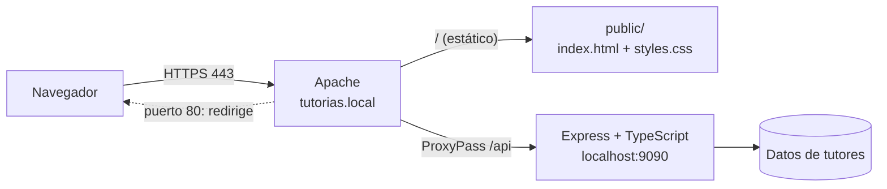

# Proyecto---GSW
# Proyecto GSW - Fase 2

## Portal de Tutorías Gratuitas

Nuestro proyecto es un portal de tutorías gratis para estudiantes de bachillerato en Matemáticas, Ciencias e Inglés.

**Integrantes:** Wendy Yessenia Flores Reyes, Anderson Saul Maravilla Callejas, Rodrigo Xavier Mejía Bermudez, Emerson Raúl Ventura Castillo y Javier Alexander Barahona Mejía.

**¿A quién ayuda y qué problema resuelve?** Ayuda a estudiantes de bachillerato con pocos recursos y a universitarios que quieren dar tutorías como voluntariado. Resuelve que quien necesita refuerzo no sabe con quién acudir y los tutores no tienen un medio ordenado para ofrecer su ayuda.

En esta fase tenemos la base funcionando: Apache sirve la página por HTTPS y las peticiones a /api se mandan con ProxyPass al backend hecho en Express con TypeScript.

## Arquitectura

```
Navegador (https://tutorias.local)
        |
        v
Apache - puerto 443 (HTTPS con certificado de mkcert)
        |
        |---- /        -> archivos de la carpeta public/ (index.html)
        |
        |---- /api/... -> ProxyPass -> Express en localhost:9090
                                              |
                                              v
                                      lista de tutores (en servidor.ts)
```

Cómo funciona:

1. El navegador entra a https://tutorias.local y Apache responde por el puerto 443 usando el certificado que hicimos con mkcert.
2. Si se pide la página principal, Apache la toma directo de la carpeta public/.
3. Si la ruta empieza con /api, Apache no la contesta, sino que la pasa a Express en el puerto 9090 con ProxyPass.
4. Express busca los tutores (y los filtra por materia si se manda el parámetro) y devuelve un JSON.
5. Apache le regresa esa respuesta al navegador.

El mismo flujo en diagrama (se ve renderizado en GitHub):



## Archivos del proyecto

- `src/servidor.ts`: el backend con Express y las rutas de la API
- `public/index.html` y `public/styles.css`: la página y sus estilos, que sirve Apache
- `docs/capturas/`: capturas de evidencia (candado HTTPS y API funcionando)
- `config/tutorias.local.conf`: virtual host para el puerto 80 (redirige a HTTPS)
- `config/tutorias.local-ssl.conf`: virtual host para el puerto 443 con SSL
- `.gitignore`: para no subir node_modules, dist ni la llave privada del certificado

## La API

| Ruta | Descripción |
|---|---|
| `GET /api/salud` | Estado del servicio |
| `GET /api/materias` | Materias disponibles |
| `GET /api/tutores` | Todos los tutores |
| `GET /api/tutores?materia=...` | Tutores de una materia |
| `GET /api/tutores/:id` | Ruta dinámica: un tutor por su id (devuelve 404 en JSON si no existe) |

`GET /api/tutores` devuelve todos los tutores.

`GET /api/tutores?materia=ingles` devuelve solo los de esa materia (no importa si se escribe con mayúsculas o incompleto, por ejemplo `?materia=mate`).

Ejemplo de respuesta:

```json
{
  "total": 1,
  "tutores": [
    { "id": 1, "tutor": "Wendy Flores", "materia": "Matemáticas", "horario": "Lun/Mié 16:00", "cupos": 4 }
  ]
}
```

## Cómo levantarlo

Nosotros usamos Windows con WSL (Ubuntu), Apache y Node.js 18 o más.

### 1. Instalar lo necesario

```bash
sudo apt update
sudo apt install -y git apache2 nodejs npm
```

### 2. Clonar el repo

```bash
sudo chown -R $USER:$USER /var/www
cd /var/www
git clone https://github.com/XavierWrx/Proyecto---GSW.git
cd Proyecto---GSW
```

### 3. Correr el backend

```bash
npm install
npm run build
npm start
```

Tiene que salir `Servidor Express corriendo en http://localhost:9090`. Esa terminal se deja abierta.

Para probar que sí responde (en otra terminal):

```bash
curl http://localhost:9090/api/tutores
```

### 4. Crear el certificado

El certificado lo creamos desde PowerShell en Windows para que el navegador confíe en él:

```powershell
winget install FiloSottile.mkcert
mkcert -install
cd $HOME
mkcert tutorias.local
```

Eso crea `tutorias.local.pem` y `tutorias.local-key.pem`. Después se copian a WSL (cambiar TU_USUARIO por el usuario de Windows):

```bash
sudo mkdir -p /etc/apache2/ssl/tutorias.local
sudo cp /mnt/c/Users/TU_USUARIO/tutorias.local*.pem /etc/apache2/ssl/tutorias.local/
```

La llave (`tutorias.local-key.pem`) no se sube al repo, por eso está en el .gitignore.

### 5. Configurar Apache

En los archivos de config/ el DocumentRoot dice `[DIRECCION DE PROYECTO]`, hay que cambiarlo por la ruta de la carpeta public. Se puede hacer con este comando:

```bash
sed -i 's#\[DIRECCION DE PROYECTO\]#/var/www/Proyecto---GSW/public#g' config/*.conf
```

Apache necesita permiso de lectura sobre los archivos de `public/`:

```bash
chmod 644 public/index.html public/*.css
```

Luego copiamos los archivos y activamos los módulos y los sitios:

```bash
sudo cp config/tutorias.local.conf config/tutorias.local-ssl.conf /etc/apache2/sites-available/
sudo a2enmod ssl proxy proxy_http
sudo a2ensite tutorias.local.conf tutorias.local-ssl.conf
sudo apache2ctl configtest
sudo service apache2 restart
```

El configtest tiene que decir `Syntax OK`.

### 6. Agregar el dominio

En Windows hay que abrir el bloc de notas como administrador y editar `C:\Windows\System32\drivers\etc\hosts`. Al final se agrega:

```
127.0.0.1   tutorias.local
```

### 7. Probar

- https://tutorias.local : tiene que cargar la página con el candado
- https://tutorias.local/api/tutores : tiene que mostrar el JSON de los tutores
- https://tutorias.local/api/tutores?materia=ciencias : solo el tutor de ciencias
- https://tutorias.local/api/tutores/2 : un solo tutor por su id (ruta dinámica)
- http://tutorias.local : tiene que redirigir a https

Para comprobar desde la terminal que Apache entrega el HTML y el CSS:

```bash
curl -s https://tutorias.local/ | head -n 15
curl -s https://tutorias.local/styles.css | head -n 5
```

## Evidencias

Las capturas del sitio con el candado y de la API funcionando por el proxy van en la carpeta [`docs/capturas/`](docs/capturas/) (pendiente). Capturas que pide la actividad: el sitio con el candado sin advertencias, la API respondiendo a través de Apache, y la terminal con Express corriendo.

## Lo que falta para las siguientes fases

El clúster con Docker (fase 3) y el balanceador con Nginx (fase 4).
